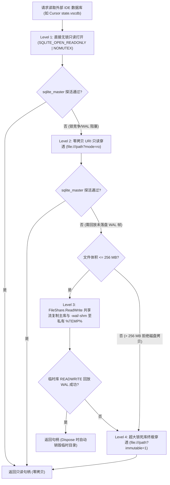
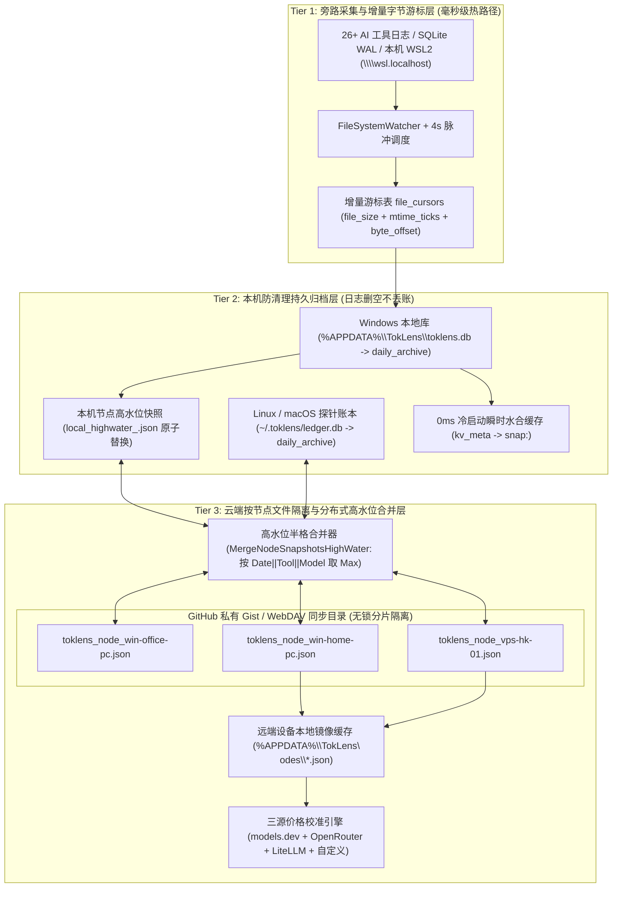
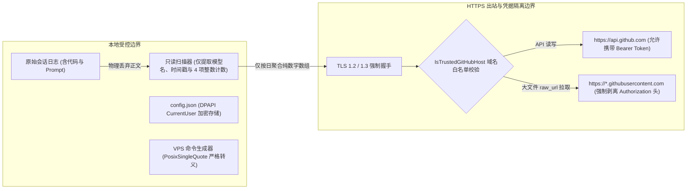

# 知微 · TokLens v2.2 系统架构白皮书

> **版本基线**：`v2.2`（Schema: `toklens.node.v2` / Local Store: `toklens.store.v2.5`）  
> **架构定位**：本地优先（Local-First）、零外部运行时依赖、跨 Windows / WSL2 / Linux VPS / macOS 的实时 AI Token 遥测与等效账单引擎

---

## 一、核心设计哲学：单文件、零依赖、免代理

目前市面上的 AI Token 统计工具普遍面临两难困境：要么需要部署本地反向代理（篡改 `ANTHROPIC_BASE_URL` / `OPENAI_BASE_URL`，一旦代理挂起即阻断开发流且无法统计历史对话），要么基于 Electron / Node.js / Python 虚拟环境打包出上百 MB 的臃肿安装包。

**知微 · TokLens v2.2** 在工程上确立了三条严苛的底层约束：

1. **零外部运行时安装（Zero Runtime Dependency）**
   - **Windows 桌面端 (`TokLens.exe`)**：直接基于每台 Windows 10 / 11 操作系统出厂内置的 **`.NET Framework 4.x` (`csc.exe`)** 与原生 **WPF** 编译，不依赖 `.NET 6/8 Desktop Runtime`、WebView2 或第三方 NuGet DLL。单可执行文件体积控制在 **`~400 KB`** 量级，双击即开。
   - **内嵌跨平台探针资源**：编译期通过 `/resource` 将 `vps/toklens_agent.py` 直接嵌入 `TokLens.exe` 程序集清单资源（`TokLens.toklens_agent.py`），在首次云同步时自动分发至私有云端，实现真正的单文件自举。
   - **Linux VPS / macOS 探针 (`toklens_agent.py`)**：100% 采用 **Python 3 标准库**（`sqlite3`、`urllib.request`、`json`、`pathlib`、`argparse`、`subprocess`）编写，**零 `pip install` 依赖**，不污染服务器系统环境。

2. **原生 `winsqlite3.dll` 四级零拷贝只读穿透**
   - 摒弃数 MB 的第三方 `System.Data.SQLite` 非托管封装，通过 `WinSqlite` 类直接 P/Invoke Windows 系统自带的 `winsqlite3.dll`（`sqlite3_open_v2`、`sqlite3_prepare_v2`、`sqlite3_step`）。
   - 针对正在被 IDE 高频独占写入的外部大型 SQLite 库（例如动辄超过 `120 MB` 的 Cursor `state.vscdb`、Zed `threads.db`、OpenAI Codex `state_5.sqlite`），`WinSqlite.OpenReadOnly` 设计了**四级无锁回退穿透状态机**：

3. **免代理旁路实时遥测（Proxy-Free Live Telemetry）**
   - 不劫持任何 API 流量或 TLS 证书。通过监听本地会话文件增量字节偏移与 SQLite WAL 变更，配合区间状态机解析器 `FastJson`（无需构造全量 JSON DOM 树即可在字符串切片内定位 `"tokenCount"`、`"timingInfo"` 等字段），在不干扰宿主 AI 工具的前提下实现毫秒级实时流追踪。

---

## 二、源码模块拓扑

仓库采用扁平高内聚的模块化结构，所有桌面端源码均可由 Windows 原生 `build.bat` 一键编译：

| 模块路径 | 核心类型 | 架构职责 |
| :--- | :--- | :--- |
| `src/ModelsAndPricing.cs` | `WinSqlite`, `PricingEngine`, `ExchangeRateService`, `RecordBucket`, `NodeSnapshot`, `SyncConfig` | 系统 `winsqlite3.dll` 互操作层、核心领域模型、三源云端价格合并引擎（含 `>200K` 超长上下文阶梯计费）与多源实时汇率缓存服务。 |
| `src/TokenScanner.cs` | `TokenScanner`, `LocalUsageStore`, `FastJson`, `FormatterUtil` | 26+ 种 AI Harness 与本机 WSL2 增量扫描引擎、`toklens.db` 游标与按日归档存储、低分配 JSON 提取器及 CLI 导出格式化器。 |
| `src/SyncService.cs` | `SyncService`, `GitHubProbeResult`, `GhCliAccountInfo` | GitHub 私有 Gist / WebDAV 双通道同步状态机、`gh` CLI 多账号发现与在线探针、高水位合并算法、DPAPI 凭据加密及 VPS 部署命令生成器。 |
| `src/UiThemeAndIcons.cs` | `DesignSystem`, `ModernWindowChrome`, `ModernControlsFactory`, `ModernDataGridFactory`, `ToastManager`, `UiIcons` | Obsidian / Paper Zinc 双主题设计令牌、冻结画刷缓存池、Win11 DWM 原生圆角与 Snap Layouts 钩子、无感状态保持表格工厂与轻量 Toast 引擎。 |
| `src/MainWindow.cs` | `Program`, `MainWindow` | 单实例入口、无头 CLI 导出与 `--self-test-ui` 布局回归验证、主窗口多视图状态编排、自愈型 `FileSystemWatcher` 与后台定时调度。 |
| `src/RequestInspectorPanel.cs` | `RequestInspectorPanel` | `300px` 实时请求取证侧栏（双币成本与缓存省钱拆解、四维 Token 构成瀑布条、延迟与 TPS 吞吐仪表、单条 JSON 导出）。 |
| `src/CommandPaletteOverlay.cs` | `CommandPaletteOverlay`, `PaletteCommandItem` | `Ctrl+K` 键盘优先全局命令面板（内置 GBK 中文拼音首字母提取与多维模糊打分索引）。 |
| `src/MiniHudWindow.cs` | `MiniHudWindow` | 桌面极简悬浮胶囊 HUD（`WS_EX_TOOLWINDOW` 免打扰、呼吸状态灯、位置锁定、多档透明度与预算超标琥珀色提醒）。 |
| `src/PricingStudioWindow.cs` | `PricingStudioWindow` | 可视化模型定价工作台（检视 2,000+ 官方/云端基准单价、编辑 `~/.toklens/custom_prices.json` 本地覆盖并即时重算全局账单）。 |
| `src/SyncWindow.cs` | `SyncWindow` | 多端云同步配置、配对码导入导出与 Linux VPS 一键部署面板。 |
| `src/HtmlExporter.cs` | `HtmlExporter` | 零外部静态资源依赖的单文件交互式多设备 HTML 汇总报表生成器。 |
| `vps/toklens_agent.py` | `MultiHarnessScanner`, `PricingLookup` | Linux VPS / macOS 纯 Python 3 标准库探针，内置 `~/.toklens/ledger.db` 高水位归档、Remote SSH 扫描与 `crontab` 自托管。 |

---

## 三、三层数据流与双层防清理高水位架构

为彻底解决 **「每次打开软件全盘重扫卡顿」**、**「AI 工具自动清理旧日志导致历史账单归零」** 以及 **「多台设备并发同步写冲突」** 三大工程难题，TokLens 构建了从字节游标到云端分片的三层单调递增数据流水线：

### 3.1 Tier 1：增量字节游标（`file_cursors`）与精准去重

Windows 端在 `%APPDATA%\TokLens\toklens.db`（Schema `toklens.store.v2.5`）中维护三张核心表：`kv_meta`、`file_cursors` 与 `daily_archive`。

- **零冗余增量扫描**：`file_cursors` 以文件完整路径为键，持久化 `file_size`、`mtime_ticks`、`byte_offset` 与紧凑序列化后的 `events_data`。
  - 当文件 `(file_size, mtime_ticks)` 未发生改变时，扫描器直接从内存游标字典 `_memCursors` 复用历史事件，**磁盘 I/O 为零**；
  - 当追加型 JSONL 会话日志增长时，直接 `Seek` 至上次记录的 `byte_offset` 处仅解析新增字节行；
  - **`0ms` 瞬时水合（Instant UI Hydration）**：主窗口初始化时同步调用 `LocalUsageStore.TryLoadInstantSnapshot` 读取 `kv_meta` 中的 `snap:<home>` 预聚合快照，首帧渲染耗时 `0ms`，彻底告别启动白屏或模态加载遮罩，随后在后台线程静默执行增量扫描刷新。
- **跨工具特殊拓扑精准治理**：
  - **Claude Desktop vs Claude Code 分流**：深度解析 `.claude` 会话记录中的 `entrypoint` 元数据与目录特征，自动区分桌面客户端对话与终端 CLI 会话。
  - **OpenAI Codex 双源互补去重**：优先解析 `~/.codex/sessions` 实时 JSONL 流，再以会话 `thread_id` 去重回填 `~/.codex/state_5.sqlite` 归档表，既保留实时单条延迟/TPS，又不漏历史归档。
  - **Zed AI 累计值跨天切片**：针对 Zed `threads.db` 中 `cumulative_token_usage` 单调累加导致跨天会话难以按日拆分的问题，`ScanZedAt` 按 `thread_id@yyyy-MM-dd` 维护历史已结算分片（Settled Slices），当日仅计入相对历史水位的净增量 `delta`，从根源上杜绝跨日重复计费与会话截断回退。

### 3.2 Tier 2：本机双层防清理持久归档（`toklens.db` & `ledger.db`）

许多 AI CLI 与 Agent 框架会定期自动轮转或清理超过 7~30 天的会话日志；VPS 运维中也常执行磁盘清理。TokLens 在本地设计了**日志生命周期解耦机制**：

1. **已删文件游标保留**：即使磁盘上的原始 `.jsonl` 会话文件已被删除，其此前解析入库的事件仍保留在本地归档中；即便升级解析器触发 `StoreSchema` 迁移（`InitializeDbTablesAndSchema`），系统也仅重扫**磁盘上仍存活的文件**，对已删除历史文件的游标与整个 `daily_archive` 表予以 100% 永久保留。
2. **按日归档高水位合并（`MergeAndSaveDailyArchive` & `ledger.db`）**：
   - Windows 端的 `toklens.db (daily_archive)` 与 Linux/macOS 探针端的 `~/.toklens/ledger.db (daily_archive)` 均以 `(日期, 工具, 模型)` 作为唯一主键。
   - 每次扫描结束时：
     - 若实时扫描结果完整覆盖归档记录（`liveCoversArchive == true`，表明原始日志完好未删），则允许采用最新同步的云端模型单价更新 `CostUsd` 与 `BaselineUsd`；
     - 一旦检测到实时扫描数值低于历史归档（表明部分历史日志已被清理删除），自动切换为高水位保护模式，对 `Turns`、`FreshInput`、`Output`、`CacheRead`、`CacheWrite` 与 `CostUsd` 严格取 `Math.Max(live, archive)`。

### 3.3 Tier 3：云端按节点文件隔离与类 CRDT 高水位合并（`MergeNodeSnapshotsHighWater`）

在多端云同步层，TokLens 拒绝将所有电脑的数据塞进同一个大 JSON 文件（那会导致办公电脑与 VPS 同时定时同步时发生 Last-Write-Wins 互相覆盖）。

1. **按节点物理文件分片（Per-Node File Isolation）**：
   - 在私有 GitHub Gist 或 WebDAV 目录中，每台设备拥有独立命名空间 `toklens_node_<machine_id>.json`（遵循 `toklens.node.v2` 紧凑数组协议）。
   - 单位电脑只写 `toklens_node_win-office-pc.json`，家里电脑只写 `toklens_node_win-home-pc.json`，Linux VPS 只写 `toklens_node_vps-hk-01.json`，彼此天然无锁隔离。

2. **状态型高水位半格合并（`SyncService.MergeNodeSnapshotsHighWater`）**：
   - 针对**同一节点**（例如重装系统后复用原 `machine_id`，或网络抖动后的重传），上传前必先拉取远端同名快照执行数学上幂等、可交换、单调递增的高水位合并：
     $$\forall k \in (\text{Date} \times \text{Tool} \times \text{Model}), \quad M[k].\text{field} = \max\big(P[k].\text{field},\; H[k].\text{field}\big)$$
   - **Write-after-Commit 防污染提交**：`SyncGist` 与 `SyncWebDav` 均先在内存中构造合并快照并向云端发起 `PATCH` / `PUT`；**唯有云端确认写入成功后**，才将合并结果原子回写至本机 `local_highwater_<id>.json`（经 `.tmp.<guid>` 临时文件 + `File.Replace` 保证断电不产生半截损坏 JSON）。
   - **单节点优雅降级**：拉取多台远端设备快照时，若个别节点文件因瞬时网络抖动解析失败，自动回退读取本地 `%APPDATA%\TokLens\nodes\` 下的高水位镜像缓存（计入 `degradedNodes` 状态提示），确保全局看板永不闪断。

3. **独立三源模型价格库与远端校准（`PricingEngine`）**：
   - 无需依赖外部计费组件，后台独立聚合三大权威公开数据源并按一等公民供应商权重（Priority）择优合并 2,000+ 模型单价：
     1. **`models.dev` 官方注册表**（直取百万 Token 单价，具备极高精度的 `cache_read` / `cache_write` 定价，一手供应商权重 `30`）；
     2. **`OpenRouter` 实时模型 API**（一手供应商权重 `25`）；
     3. **`LiteLLM` 开源价格表**（jsDelivr CDN + GitHub Raw 双链路互备，一手供应商权重 `20`）。
   - 支持 **超长上下文阶梯计费**（`ApplyLongContextTierIfApplicable`：针对单轮平均上下文超过 `200K` Tokens 的 Claude Sonnet 4 系列与 Gemini 2.5 / 3.x Pro 系列自动应用 `2x` 输入 / `1.5x` 输出阶梯倍率），并通过 `RecalculateRemoteSnapshot` 自动对远端 VPS 上报的兜底单价执行二次精准重算。

---

## 四、安全与隐私边界（Security & Privacy Boundaries）

作为直接扫描本地开发者目录与持有云同步凭据的桌面基础设施，TokLens 在每一处 I/O 边界均实施了纵深防御：

### 4.1 100% 零 Prompt 与零代码采集（物理级脱敏）
- **内存不留存**：`UsageEvent` 与 `RecordBucket` 数据结构中仅包含 `Tool`、`Model`、`Date`、`TimestampMs`、`DurationMs` 及 `FreshInput / CacheRead / CacheWrite / Output` 整型计数，没有任何字符串字段用于存放对话文本、系统提示词、工具调用参数、代码片段或本地项目文件夹名称。
- **云端全聚合**：同步上云的 `toklens.node.v2` 快照仅包含按 `(日期, 工具, 模型)` 聚合后的二维纯数字矩阵（连单次请求的时间戳都不上传云端），即使使用 WebDAV 或私有 Gist，也绝无泄露任何商业源码或对话隐私的可能。

### 4.2 本地凭据加密存储（Windows DPAPI & POSIX `0600`）
- **Windows DPAPI 当前用户绑定**：`SyncService.SaveConfig` 在持久化 `gist_token` 与 `webdav_pass` 前，强制通过 `ProtectedData.Protect(raw, DpapiEntropy, DataProtectionScope.CurrentUser)`（配合专属熵 `"TokLens.LocalCredential.v2"`）加密为 `dpapi:<Base64>` 密文。即便 `%APPDATA%\TokLens\config.json` 被恶意软件或备份脚本拷走，脱离当前 Windows 登录账户的系统级主密钥也无法还原明文。
- **Linux / macOS 最小权限锁死**：`toklens_agent.py` 在创建或更新 `~/.toklens/config.json` 与 `~/.toklens/ledger.db` 时，自动调用 `os.chmod(path, 0o600)`，严禁同机其他非特权用户读取。

### 4.3 POSIX 单引号闭合防命令注入
- 桌面端在拼接 Linux VPS 一键 SSH 部署命令时，所有动态参数（包括用户自由输入的 `vpsDisplayName`、Base64 配对码及内联引导脚本）一律经过 `SyncService.PosixSingleQuote`（将任意单引号 `'` 替换为闭合转义序列 `'\''` 并首尾加单引号）处理；
- 调用本地 `gh` CLI 提取指定账号令牌时，用户名参数强制通过 `SanitizeGhUserArg`（严格限制 `[a-zA-Z0-9_.-]`）白名单过滤，且 `ProcessStartInfo.UseShellExecute = false` 不经过 `cmd.exe` 解释器，彻底阻断命令注入向量。

### 4.4 HTTPS 域名白名单与 Authorization 凭据隔离
- 当单个节点的历史快照极大触发 GitHub Gist API `truncated: true` 时，客户端需跟随返回体中的 `raw_url` 拉取完整内容。
- 为防范恶意篡改或跨域重定向窃取 GitHub Token，`SyncService.IsTrustedGitHubHost` 实施了双层校验：
  1. 强制要求协议必须为 `https://`；
  2. **仅当 Host 精确匹配 `api.github.com` 时才发送 `Authorization: Bearer` 头**；当跟随至 `gist.githubusercontent.com` 或 `*.githubusercontent.com` 静态内容节点时，自动将鉴权头置空（`sendAuthHeader = false`），确保高权限令牌永不离开官方 API 主域。
- 此外，`HtmlExporter` 在导出离线 HTML 报表内嵌 JSON 数据时，对 `</` 与 `<!--` 执行 `<\/` 与 `<\!--` 转义，阻断异常模型标识引发的 DOM XSS 脚本逃逸。

---

## 五、Obsidian / Paper Zinc 设计系统与全高多视图架构

TokLens v2.2 在桌面交互层摒弃了传统工具软件堆叠挤压的「上下分栏 + 弹窗套弹窗」模式，全面重构为对标 **Linear、Vercel Geist、OpenRouter Activity 与 OrbStack** 的现代高密度桌面架构。

### 5.1 双主题语义令牌与零分配渲染管线（`DesignSystem`）
- **Obsidian（深色）与 Paper Zinc（浅色）双色板**：
  - 深色模式采用低眩光高对比度锌黑基底（窗口 `#09090B`、侧边栏 `#121215`、卡片 `#16161A`、微边框 `#232329`、主强调靛蓝 `#6366F1` / `#818CF8`）；
  - 浅色模式采用清爽纸白层级（窗口 `#F8F9FA`、纯白卡片 `#FFFFFF`、边框 `#E4E4E7`、深靛蓝 `#4F46E5`）。
- **冻结画刷缓存池（`BrushCache`）**：所有十六进制颜色经 `DesignSystem.BrushHex` 解析后立即调用 `SolidColorBrush.Freeze()` 冻结为线程安全不可变对象并驻留字典，杜绝高频刷新时的托管堆 GC 抖动。
- **供应商语义色与确定性哈希**：`GetProviderColorHex` 为 Anthropic Claude、OpenAI Codex、Cursor、Google Gemini / Antigravity、DeepSeek / OpenClaw、Kimi、Qwen、GLM / ZCode 赋予专属高辨识度主题色，未知长尾工具则通过 **32 位 FNV-1a 哈希**稳定映射至主题色板。

### 5.2 原生无边框窗口与 Windows 11 DWM 深度融合（`ModernWindowChrome`）
- 结合 WPF `WindowChrome` 与 `dwmapi.dll` 原生属性（`DWMWA_USE_IMMERSIVE_DARK_MODE`、`DWMWCP_ROUND` 硬件级圆角裁剪、`DWMWA_BORDER_COLOR` 硬件级 `1px` 主题边框色），消除传统 Win32 白边与阴影割裂。
- **原生 Snap Layouts 分屏悬停钩子**：在自绘标题栏最大化按钮上通过 `HwndSource.AddHook` 精准响应 `WM_NCHITTEST` 并返回 `HTMAXBUTTON (9)`，使无边框自定义窗口依然支持鼠标悬停最大化按钮呼出 **Windows 11 原生分屏布局菜单**，并在最大化时按当前显示器 DPI 缩放矩阵动态补偿 `SM_CXSIZEFRAME + SM_CXPADDEDBORDER`。

### 5.3 六大全高主视图与 `0.0px` 零像素位移契约
1. **一体化导航骨架**：由严格锁死高度的全局顶栏、可折叠侧边导航栏（展开 `200px` / 紧凑图标态 `58px`）及右侧全高内容舞台组成，划分为 **概览看板、实时请求流、模型与工具、设备与集群、每日流水与导出、同步与设置** 六大独立视图。
2. **全自动几何稳定性门禁（`--self-test-ui`）**：工程内置无头 WPF 布局回归自检模式，在 CI 流水线（`.github/workflows/ci.yml`）中自动测量模拟多节点切换、时间跨度切换、视图切换及深浅色主题翻转前后的关键容器像素高度，断言位移误差严格小于 `0.05px`。
3. **无感状态保持表格引擎（`ModernDataGridFactory.UpdateItemsPreservingState`）**：
   - 全数字与金额列强制启用 OpenType 等宽数字特性（`FontNumeralAlignment.Tabular` + `Cascadia Mono / JetBrains Mono`），数值跳动时列宽与小数点纹丝不动；
   - 后台每 `4s` 或 `FileSystemWatcher` 触发增量数据替换时，自动捕获并无损恢复用户的**自定义列排序方向、当前选中行唯一键及横纵向滚动条偏移量**，不断流、不跳顶。
4. **四大高阶生产力子系统**：
   - **`RequestInspectorPanel`（实时请求取证侧栏）**：点击任意实时请求即可在右侧 `300px` 抽屉透视双币种单次成本、Prompt Cache 省钱金额与比例、四维 Token 构成瀑布条、延迟档位与 `tok/s` 吞吐仪表，并支持一键导出取证 JSON。
   - **`CommandPaletteOverlay`（`Ctrl+K` 全局命令面板）**：支持中英文关键词、快捷键与中文拼音首字母（如输入 `tb` 匹配「同步」、`dc` 匹配「导出」）毫秒级模糊检索跳转。
   - **`MiniHudWindow`（极简桌面悬浮胶囊 HUD）**：采用 `WS_EX_TOOLWINDOW` 扩展样式隐藏出 `Alt+Tab` 队列，三段式等宽胶囊常驻桌面一角实时呈现「今日花费 · 总 Token · 最新活跃模型与 TPS」，支持自由拖拽、位置锁定、三档透明度（`100% / 85% / 65%`）及超每日预算琥珀色呼吸提醒。
   - **`PricingStudioWindow`（模型定价工作台）** 与 **`ToastManager`（非模态通知栈）**：所有后台同步、复制与导出反馈均以右下角轻量滑入卡片呈现，彻底终结模态 `MessageBox` 对心流的打断。
