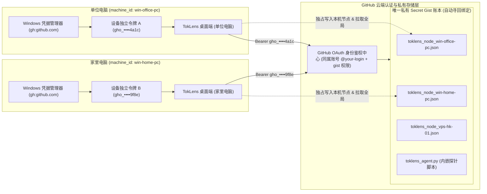
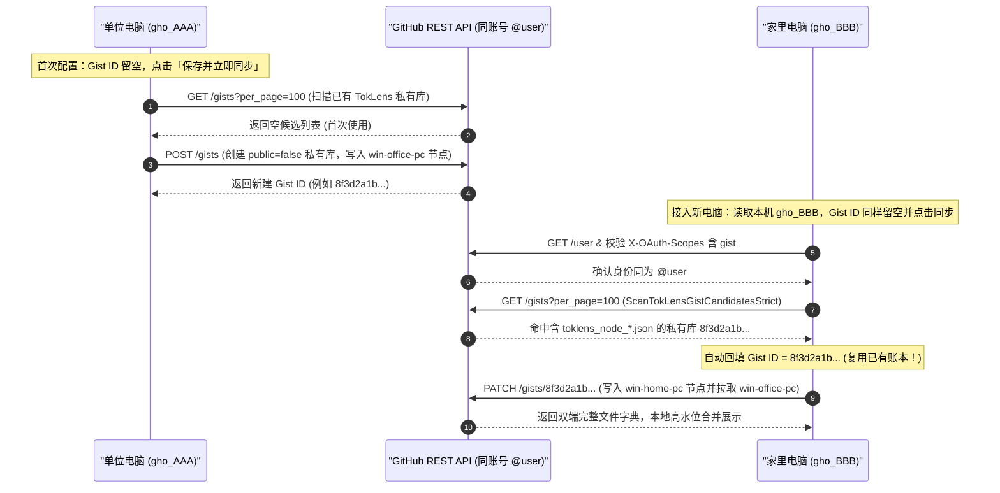

# 知微 · TokLens — 跨设备云同步与 GitHub 令牌完全排障指南

> **适用版本**：知微 · TokLens `v2.2`（桌面端 `TokLens.exe` & 跨平台探针 `toklens_agent.py`）  
> **核心同步协议**：`toklens.node.v2`（100% 按日脱敏统计数字，零对话原文、零 Prompt 上传）

在将 **办公电脑**、**家里电脑** 与 **Linux VPS / macOS** 接入知微 · TokLens 多端账单同步时，许多熟悉命令行的开发者都会注意到一个现象：

> **「我在单位电脑和家里电脑分别点击『读取 gh 登录账号』，发现两台电脑读取出的 `gho_...` 令牌字符串完全不一样！为什么填进去不同的 Token，不填 Gist ID，两台电脑却能自动找到同一个账单库并正常互通？」**

本文将首先通过底层架构图解彻底讲透这一机制，随后针对 **5 类真正会导致同步异常的场景** 提供精准诊断与一键修复步骤，最后附上 **WebDAV（坚果云 / Nextcloud / 群晖 Synology）** 配置要点与 **Linux VPS / macOS 配对码部署全流程**。

---

## 一、核心解惑：为什么家里电脑和单位电脑的 `gh` 令牌不一样，却能正常互通？

### 1.1 一句话结论

**这是 GitHub CLI (`gh`) 的标准安全设计，完全正常，无需手动把同一串 Token 从单位电脑复制到家里电脑。**

两台电脑上的 `gho_...` 令牌虽然**字符串不同**，但只要它们是在**同一个 `@用户名` 的 GitHub 账号**下授权签发的，且都具备 `gist` 权限，它们在 GitHub 服务端就映射向**同一个账号身份与同一个私有 Gist 账本**。

### 1.2 底层机制全景图解

当你在不同电脑上执行 `gh auth login` 时，GitHub CLI 采用 **OAuth 2.0 Device Flow（设备授权流）**。GitHub 认证服务器会为每一台物理设备**独立签发一枚以 `gho_` 开头的设备级 OAuth 访问令牌**，并分别加密保存在各台电脑本地的 **Windows 凭据管理器（Windows Credential Manager，`gh:github.com`）** 中：



### 1.3 为什么「不填 Gist ID」也不会建出两个孤立账本？

许多用户担心第二台电脑留空 `Gist ID` 会不会再新建一个空白 Gist。实际上，`SyncService.FindOrCreatePrivateGist` 内部实现了严格的**先检索、后复用、绝不盲目新建**时序协议：



**技术设计优势：**
1. **安全最小化爆炸半径**：每台电脑持有独立的 `gho_...` 设备令牌。若某台旧电脑退役或遗失，只需在 GitHub 网页端「Settings → Applications → Authorized OAuth Apps → GitHub CLI」或该机执行 `gh auth logout` 吊销单台设备授权，其余电脑与 VPS 完全不受影响。
2. **本地 DPAPI 二次加固**：TokLens 将读取到的令牌写入 `%APPDATA%\TokLens\config.json` 时，会调用 Windows 原生 `ProtectedData.Protect`（DPAPI 当前用户级加密，前缀 `dpapi:`），绝不在磁盘留存明文 Token。
3. **常见令牌前缀对照表**（对应 `SyncService.DescribeTokenKind` 识别逻辑）：

| 令牌前缀 | 类型名称 | 多机字符串是否相同 | TokLens 兼容性与推荐度 |
| :--- | :--- | :--- | :--- |
| `gho_...` | GitHub CLI 设备独立 OAuth 令牌 | **每台电脑均不同**（同账号天然互通） | **五星推荐**（免网页申请，一键读取） |
| `ghp_...` | 经典个人访问令牌 (Classic PAT) | 手动粘贴同一串则相同，也可各建各的 | **五星推荐**（网页勾选 `gist` 即可，适合 VPS 长期使用） |
| `github_pat_...` | 细粒度个人访问令牌 (Fine-grained PAT) | 取决于创建方式 | **不推荐**（默认面向特定仓库，常因缺少账户级 Gists 写权限报错） |
| `ghu_...` / `ghs_...` | GitHub App 用户 / 服务端令牌 | 动态签发且通常含短效过期时间 | 仅限特定集成环境，不建议用于长期桌面同步 |

---

## 二、5 类真正会导致同步异常的场景与一键修复步骤

既然「`gho_` 字符串不同」不是问题，那么什么情况才会真正导致两台电脑无法互通或同步报错？以下是 `SyncService` 在线诊断引擎覆盖的 **5 大真实异常根因与标准修复方案**。

---

### 场景 ①：`gh` CLI 登录了多个 GitHub 账号（工作号 vs 个人号错位）

#### 症状表现
- 单位电脑和家里电脑同步均显示「成功」，但两边看不到对方的设备数据；
- 或者在「同步与设置」中看到识别出的 `@用户名` 与另一台电脑不一致（例如单位电脑绑了 `@company-work`，家里电脑绑了 `@my-personal`）。

#### 底层原因
新版 GitHub CLI 支持在同一台电脑上登录多个 `github.com` 账号（通过 `Active account: true / false` 区分当前激活账号）。如果两台电脑各自读取了不同 GitHub 账号下的令牌，它们自然会分别访问两个完全隔离的私有 Gist 账本。

#### 一键修复步骤
1. **方式 A（在 TokLens 应用内直接按账号选择 · 推荐）**：
   - TokLens 内置 `SyncService.DiscoverGitHubCliAccounts` 多账号发现器，能够解析 `gh auth status -h github.com` 中的全部已登录账号。
   - 打开 **「同步与设置」** → 点击 **「读取 gh 登录账号」**，若本机存在多个账号，直接点选你用于存放账单的统一账号（如 `@my-personal`），内部会自动调用 `gh auth token -h github.com -u <username>` 精准提取该账号令牌。
   - **清空 `私有 Gist ID` 输入框**，点击 **「保存并立即同步」**，即可自动寻回该账号下的主账本。
2. **方式 B（在终端核查并切换默认激活账号）**：
   ```powershell
   # 查看本机已登录的所有 GitHub 账号及当前 Active 状态
   gh auth status -h github.com

   # 将目标账号切换为本机默认激活账号
   gh auth switch -h github.com -u <你的统一GitHub用户名>
   ```

---

### 场景 ②：`GH_TOKEN` 或 `GITHUB_TOKEN` 环境变量静默覆盖

#### 症状表现
- 你在终端明明刚执行过 `gh auth login` 登录了正常账号，但其他工具或命令行始终提示 `HTTP 401 Bad credentials` 或权限受限；
- 系统环境中曾为某个 CI 脚本、Docker 容器或第三方 Agent 配置过全局 `GH_TOKEN` 或 `GITHUB_TOKEN`（例如一枚早已过期或仅有单仓库只读权限的受限 Token）。

#### 底层原因
按照 GitHub CLI 官方优先级设计，一旦当前进程环境中存在非空的 `GH_TOKEN` 或 `GITHUB_TOKEN` 环境变量，`gh` 会**强制忽略** Windows 凭据管理器中正常登录的账号凭据，直接使用环境变量中的值。

> [!TIP]
> **TokLens v2.2 内置防劫持保护**：`SyncService.RunGhProcess` 在读取本机 `gh` 账号列表与令牌时，已默认剥离子进程环境中的 `GH_TOKEN`、`GITHUB_TOKEN`、`GH_ENTERPRISE_TOKEN` 与 `GH_HOST`，优先直读凭据管理器中的真实登录态，并通过 `DetectGitHubTokenEnvOverride` 主动检测环境变量覆盖。但若你的终端自身仍受残留环境变量干扰（例如无法运行 `gh auth refresh`），建议清理该全局环境变量。

#### 一键修复步骤
打开 PowerShell 执行以下命令排查并清理残留环境变量：

```powershell
# 1. 检查当前会话、用户级与系统级是否存在覆盖变量
[pscustomobject]@{
    Process_GH_TOKEN     = $env:GH_TOKEN
    Process_GITHUB_TOKEN = $env:GITHUB_TOKEN
    User_GH_TOKEN        = [Environment]::GetEnvironmentVariable("GH_TOKEN", "User")
    User_GITHUB_TOKEN    = [Environment]::GetEnvironmentVariable("GITHUB_TOKEN", "User")
    Machine_GH_TOKEN     = [Environment]::GetEnvironmentVariable("GH_TOKEN", "Machine")
}

# 2. 一键清除当前会话及当前用户级残留变量（若无需全局保留）
Remove-Item Env:\GH_TOKEN -ErrorAction SilentlyContinue
Remove-Item Env:\GITHUB_TOKEN -ErrorAction SilentlyContinue
[Environment]::SetEnvironmentVariable("GH_TOKEN", $null, "User")
[Environment]::SetEnvironmentVariable("GITHUB_TOKEN", $null, "User")
```

清理后重新打开终端或回到 TokLens 点击「读取 gh 登录账号」即可。

---

### 场景 ③：令牌缺少 `gist` 权限范围（Scope 不足或误用 Fine-grained PAT）

#### 症状表现
- 提示：`已识别账号 @xxx，但令牌缺少 gist 权限（当前权限：repo, read:org）`；
- 或提示：`该细粒度令牌未开启 Gists 读写权限`。

#### 底层原因
TokLens 在调用 GitHub API 时会严格校验响应头 `X-OAuth-Scopes` 是否包含 `gist`：
1. 部分早期或自定义参数执行 `gh auth login` 的环境未包含 `gist` scope；
2. 若用户在 GitHub 网页端创建了新版 **Fine-grained PAT (`github_pat_...`)**，由于细粒度令牌主攻单仓库权限控制，默认不授予账户级 Gist 创建与修改权限。

#### 一键修复步骤
- **如果你使用 GitHub CLI (`gh`)**：在 PowerShell 或终端执行以下一行命令，按提示在浏览器点击授权即可原位补齐 `gist` 权限：
  ```powershell
  gh auth refresh -h github.com -s gist
  ```
  完成后回到 TokLens「同步与设置」，再次点击 **「读取 gh 登录账号」** → **「保存并立即同步」**。
- **如果你不使用 `gh` CLI**：点击界面上的 **「网页申请 Token」**（自动跳转至预勾选 `gist` 权限的 Classic PAT 创建页 `https://github.com/settings/tokens/new?description=TokLens-Sync&scopes=gist`），生成 `ghp_...` 令牌粘贴保存即可。

---

### 场景 ④：跨账号切换后残留旧 `Gist ID`，引发 `PATCH 404`

#### 症状表现
- 同步时报错：`HTTP 404` 或提示 `当前 GitHub 令牌无权写入该 Gist（该库归属于 @旧账号，或细粒度令牌缺少 Gists 写权限）`。

#### 底层原因
这是 GitHub Gist API 的经典安全行为：
- 私有 Secret Gist 允许任何知晓其 32 位哈希 ID 的请求执行只读 `GET`；
- 但当非 Owner 账号发起写入请求 `PATCH https://api.github.com/gists/{gist_id}` 时，GitHub 出于防枚举安全考量，**不会返回 `403 Forbidden`，而是统一返回 `404 Not Found`**！
- 当你更换了新的 GitHub 账号 Token，但 `私有 Gist ID` 输入框里还残留着上一个账号创建的 Gist ID 时，就会触发此错误。

> [!IMPORTANT]
> **本地零污染保证（Write-after-Commit）**：`SyncService.SyncGist` 严格先在内存中预合并并执行远端 `PATCH` 提交；若 `PATCH` 因跨账号返回 `404`，程序会立即中止异常并拦截落盘，绝不会把旧账号 Gist 中的设备数据混入本机高水位缓存。

#### 一键修复步骤
1. **想使用当前新账号同步**：直接将「同步与设置」中的 **`私有 Gist ID` 输入框彻底清空**，然后点击 **「保存并立即同步」**。TokLens 会自动在新账号名下查找已有同步库或创建新的专属私有 Gist。
2. **想继续写入原来的账本**：将 Token 切换回提示中显示的原归属账号 `@旧账号` 即可恢复写入。

---

### 场景 ⑤：电脑重装系统、更换主机或修改设备 ID 后的高水位无损迁移

#### 症状表现
- 主力 Windows 电脑重装了系统，`%APPDATA%\TokLens` 本地目录已清空，担心此前几个月的 Token 历史账单归零，或者重装后主机名变化导致列表里出现「两台办公电脑」。
- 或在「同步与设置」中主动修改了本机的「设备唯一 ID (`machine_id`)」。

#### 底层原因与保护机制
TokLens 采用**本地 SQLite 归档 + 本机高水位文件 + 云端按节点快照高水位合并（`MergeNodeSnapshotsHighWater`）**三重保护：
- **情况 A：应用内修改 `machine_id`（自动迁移清理）**  
  当你直接在已运行的电脑上修改设备 ID 并保存时，`SyncService.MigrateLocalMachineId(oldId, newId)` 会自动把本地 `local_highwater_<oldId>.json` 合并至新 ID，并将旧 ID 记入待清理队列 `PendingObsoleteMachineIds`。下一次同步时，程序会自动把云端旧文件 `toklens_node_<oldId>.json` 的历史记录无损并入新文件 `toklens_node_<newId>.json`，随后原子删除云端旧文件，不留残影！
- **情况 B：电脑格式化重装系统后恢复原设备身份**  
  重装系统后，虽然本地磁盘为空，但云端私有 Gist / WebDAV 里依然完整保留着 `toklens_node_<原machine_id>.json` 的全部历史按日账单。

#### 一键修复步骤（重装系统无损恢复）
1. 在重装好的 Windows 上打开 `TokLens.exe` → 进入 **「同步与设置」**。
2. 将 **显示名称** 改回原来的名称（如 `办公电脑`），并将 **设备唯一 ID** 精确填写为重装前的 ID（如 `win-office-pc`；若忘记，可先在另一台电脑的「设备与集群」列表或私有 Gist 文件名 `toklens_node_<id>.json` 中查看）。
3. 读取 `gh` 登录或粘贴配对码，点击 **「保存并立即同步」**。
4. `SyncGist` / `SyncWebDav` 会在上传前先自动拉取云端已有的 `toklens_node_win-office-pc.json`，与新系统当前扫描结果按 `日期 + 工具 + 模型` 执行 `Math.Max` 高水位合并，并回写本地高水位缓存——**过往所有历史日期的 Token 与费用瞬间 100% 满血恢复，一分不丢！**

> *注：如果你是买了一台**全新的第二台电脑**，请保持两台电脑的 `设备唯一 ID` 彼此不同（如 `win-office-pc` 与 `win-home-pc`），切勿设为相同 ID，否则两台同时在用的电脑会合并为同一个节点。*

---

## 三、WebDAV 网盘同步配置要点（坚果云 / Nextcloud / 群晖 Synology）

若所处网络环境不便直连 `api.github.com`，可在「同步与设置 → 云端同步通道」中一键切换为 **「WebDAV 网盘」**。TokLens 使用标准 RFC 4918 协议（`MKCOL` 自动建目录 + 带标准 XML 请求体与 `Depth: 1` 的 `PROPFIND` 列表检索 + `GET / PUT / DELETE`），完美兼容主流私有云与公有网盘。

### 3.1 主流服务端地址与凭据规范

| WebDAV 服务商 | 推荐文件夹 URL 格式示例 | 账号与密码配置要点 |
| :--- | :--- | :--- |
| **坚果云 (Jianguoyun)** | `https://dav.jianguoyun.com/dav/TokLens/` | **必读**：① 坚果云禁止第三方客户端通过 `MKCOL` 在根目录直接新建顶层同步文件夹，请先在坚果云网页端手动新建名为 `TokLens` 的文件夹；② 密码栏必须填写网页端「账户信息 → 安全选项 → 第三方应用管理」生成的**专用应用密码**，不可填写登录密码。 |
| **Nextcloud / ownCloud** | `https://cloud.example.com/remote.php/dav/files/<用户名>/TokLens/` | 建议在 Nextcloud「个人设置 → 安全 → 设备与会话」中创建独立的 **应用密码 (App Password)** 填入，支持开启双因素认证 (2FA) 的账号。 |
| **群晖 Synology NAS** | `https://nas.example.com:5006/TokLens/` | 在套件中心启用 **WebDAV Server**（默认 HTTPS 端口 `5006`，内网 HTTP 为 `5005`），确保所用 DSM 账号对该共享目录拥有**可读写**权限；公网访问强烈建议开启 HTTPS 与有效证书。 |
| **Alist / Apache `mod_dav` / Caddy** | `https://dav.example.com/dav/TokLens/` | TokLens 已针对严格校验 XML Body 的 `mod_dav` 与 Nextcloud 内置了标准 `<D:propfind>` 请求体，开箱兼容。 |

### 3.2 WebDAV 常见排障速查
- **`HTTP 401 Unauthorized`**：90% 为坚果云或开启了 2FA 的 Nextcloud 直接填写了网页登录密码而非「应用专用密码」，或 Nextcloud URL 中的 `<用户名>` 拼写与实际 UID 不一致。
- **`HTTP 403 / 409 Conflict`**：坚果云未提前在网页端创建顶层子目录（如 `/dav/TokLens/`），创建后重试即可。
- **凭据安全**：WebDAV 应用密码在本地 `config.json` 中同样受 Windows DPAPI（`dpapi:...`）加密保护。

---

## 四、Linux VPS 与 macOS 探针（配对码 `toklens1:`）部署全流程

对于无图形界面的 **Linux 开发机 / 海外 VPS**（常见运行 Claude Code、OpenAI Codex、OpenClaw、Aider 或作为 **VS Code / Cursor Remote SSH** 远端宿主机）以及 **macOS** 终端环境，TokLens 提供了零第三方依赖的单文件探针 `toklens_agent.py`（仅需系统自带 Python 3.7+ 标准库，无需 `pip install` 任何包）。

### 4.1 配对码（`toklens1:...`）工作原理

当你在已配置好云同步（GitHub Gist 或 WebDAV）的 Windows 桌面端点击 **「复制配对码」** 或生成一键部署命令时，`SyncService.GeneratePairingCode` 会将云端通道配置打包为轻量 Base64 字符串：
- 前缀标识：`toklens1:`
- 载荷字段：`provider`（`gist` 或 `webdav`）、`gist_id` + `gist_token`（或 `webdav_url` + `webdav_user` + `webdav_pass`）以及时区偏移 `tz_offset_min`
- **注意**：配对码内含云端写入凭据，请视同密码妥善保管，切勿公开张贴在公共群组或工单中。

### 4.2 Linux VPS 一键 SSH 部署（推荐，30 秒完成）

1. **前置准备**：在 Windows 桌面端完成首次「保存并立即同步」（此步骤会自动把最新内嵌版 `toklens_agent.py` 上传至你的私有 Gist 或 WebDAV 目录）。
2. **生成部署命令**：在桌面端进入 **「同步与设置 → 接入其他电脑 / Linux VPS」**：
   - 输入 **VPS 显示名称**（如 `香港主力 VPS`）；
   - 设置 **定时上报间隔**（默认 `30` 分钟，有效范围 `5` ~ `59` 分钟）；
   - 点击 **「复制一键部署命令」**。
3. **SSH 粘贴执行**：登录目标 Linux VPS（或 macOS 终端），直接粘贴命令回车。生成命令采用严格的 `PosixSingleQuote` 单引号防注入封装，自动依次完成以下 4 步：
   ```bash
   mkdir -p ~/.toklens \
     && python3 -c '<内置安全引导器：使用配对码从私有 Gist/WebDAV 拉取 toklens_agent.py>' 'toklens1:...' \
     && python3 ~/.toklens/toklens_agent.py --pair 'toklens1:...' --name '香港主力 VPS' --sync --install-cron 30
   ```
   - **Step 1**：拉取并落盘 `~/.toklens/toklens_agent.py`；
   - **Step 2**：解析配对码生成 `~/.toklens/config.json`，并自动执行 `chmod 600` 锁死当前 Linux 用户独享读写权限；
   - **Step 3**：全盘扫描当前用户主目录（含 `~/.vscode-server`、`~/.cursor-server` Remote SSH 插件日志及 26+ AI 工具），写入本地防清理 SQLite 归档库 `~/.toklens/ledger.db`（`chmod 600`），并与云端执行高水位合并上传 `toklens_node_<machine_id>.json`；
   - **Step 4**：向当前用户的 `crontab` 幂等写入带 `# toklens-auto-sync` 标记的静默定时任务（重复执行只会更新间隔，绝不产生重复条目）。

### 4.3 离线手动部署与 macOS / 进阶 CLI 运维速查

若目标机器需要离线拷贝脚本，可在桌面端点击 **「单独导出 `toklens_agent.py` 脚本」**（或直接取仓库中的 `vps/toklens_agent.py`）上传至服务器 `~/.toklens/toklens_agent.py`：

```bash
# 1. 首次配对并立即同步（适用于 Linux / macOS）
python3 ~/.toklens/toklens_agent.py \
  --pair 'toklens1:eyJwcm92aWRlciI6Imdpc3Qi...' \
  --name 'MacBook-Pro-M4' \
  --id 'mac-mbp-m4' \
  --sync

# 2. 日常手动触发一次增量扫描与云同步（已保存 ~/.toklens/config.json 后无需再传 --pair）
python3 ~/.toklens/toklens_agent.py --sync

# 3. 仅在本地测试扫描并导出 JSON 快照（不联网上传）
python3 ~/.toklens/toklens_agent.py --export ~/toklens_local_check.json

# 4. 指定扫描其他 Linux 用户目录（如 root 运维查看子用户目录）
python3 ~/.toklens/toklens_agent.py --home /home/devuser --name 'Dev-Server' --sync

# 5. 查看已安装的定时同步任务
crontab -l | grep toklens-auto-sync

# 6. 停用并移除定时同步任务（保留本地 ~/.toklens/ledger.db 历史账本）
crontab -l | grep -v 'toklens-auto-sync' | crontab -
```

---

## 五、一分钟快速自检清单（Troubleshooting Checklist）

遇到同步疑问时，按以下 4 条顺序核对即可在 1 分钟内定位：

1. **看「令牌字符串不同」是否正常？** → 两台电脑都是 `gho_...` 且不一样是**完全正常的**，只要它们对应的 GitHub `@用户名` 相同即可。
2. **看两边是否为同一个 `@用户名`？** → 运行 `gh auth status` 或在界面查看账号标识；若不同，切换统一账号并**清空 `Gist ID`** 重试。
3. **看是否缺少 `gist` 权限？** → 终端运行 `gh auth refresh -h github.com -s gist` 一键补齐，随后重新读取登录。
4. **看是否因换号报 `HTTP 404`？** → 清空残留的旧 `私有 Gist ID` 输入框，点击「保存并立即同步」让程序自动关联当前账号的私有库。
